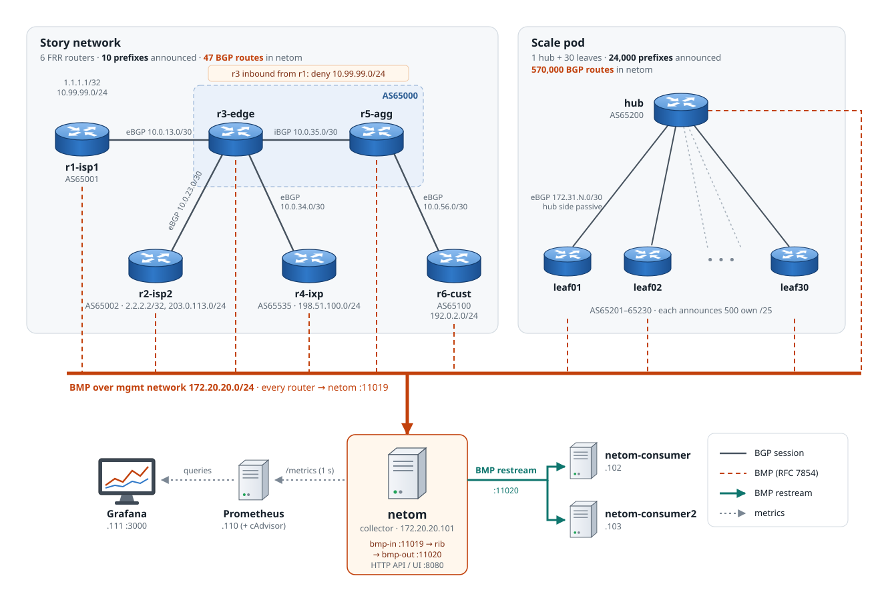
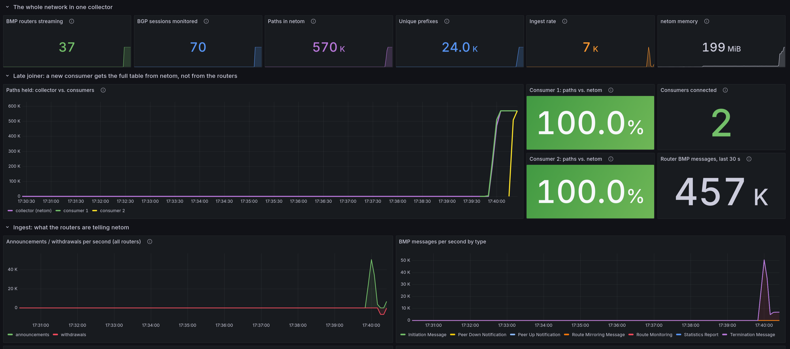

# BMP + netom scale lab

Containerlab lab: 37 FRR routers stream BMP into [netom](https://github.com/FastNetMon/netom) (~570k paths, live churn).

> Idea and design of the lab: mine. Implementation: Claude Opus 5.5.



## Idea

BMP lets a router push its BGP view to a collector: every path from every peer, before and after policy,
without a BGP session to the collector and without logging into the router. The lab starts small and makes
that visible (r3 filters a prefix, netom shows it only pre-policy), then turns BMP on for 31 more routers at
once and adds churn to show what happens at scale.

**netom** (FastNetMon's fork of NLnet Labs Rotonda) sits in the middle. It collects BMP from all routers into
one RIB that you query via UI, API and CLI, and it **re-streams BMP** to other tools. To a consumer, netom looks
like one big BMP router: a new consumer gets the full table from netom's RIB, then live updates. The routers keep
one BMP session each, however many consumers there are. In the lab, two more netom instances play those consumers.

## Deploy

Needs Docker, containerlab >= 0.81, python3, jq, curl. Run as root, or as a user in the `docker` and `clab_admins` groups.
Tested on 6 vCPU / 12 GB RAM: at the default size the host peaked at ~4 GB used and ~5.5 cores busy (act 3).

```bash
./lab.sh deploy     # ~1.5 min, ends ready for act 1
./lab.sh status
./lab.sh destroy
```

Grafana `http://<host>:3000/d/netom-scale` · netom UI `:8080` · consumers `:8081` / `:8082` · Prometheus `:9090`

## Scale

```bash
./lab.sh scale -n 40          # live, on the running lab
./lab.sh deploy -n 20 -k 800  # fresh deploy with a different size
```

`-n` leaves (30, max 79) · `-H` prefixes hub → each leaf (8000) · `-k` prefixes each leaf → hub (500) · `-c` churn prefixes (1000).
Unset options keep their last value. Paths in netom ≈ `n × (H + c) × 2 + n × k × 2`.

## Demo (`demo/`, Enter between steps, `NOPAUSE=1` to skip)

| Script | What happens |
|---|---|
| `0-prepare.sh` | Reset: only r1–r6 stream BMP, consumers off |
| `1-base.sh` | r3 drops `10.99.99.0/24`: visible pre-policy only (netom diff page) |
| `2-consumer.sh` | Consumer 1 connects to netom's restream |
| `3-scale-up.sh` | BMP on for hub + all leaves at once, checks counts |
| `4-churn.sh [stop]` | Churn every 8 s (~5–15k route events/s) |
| `5-consumer2.sh` | Consumer 2 joins during churn, gets the full table from netom |

## Dashboard



- **Top row:** routers, sessions, paths, prefixes, ingest rate, netom memory
- **Late joiner:** paths in collector vs. consumers, completeness %. Router messages stay flat: consumers don't load the routers
- **Ingest:** announcements/withdrawals, BMP message types, per-router table
- **Cost:** CPU/memory of netom vs. consumers vs. routers